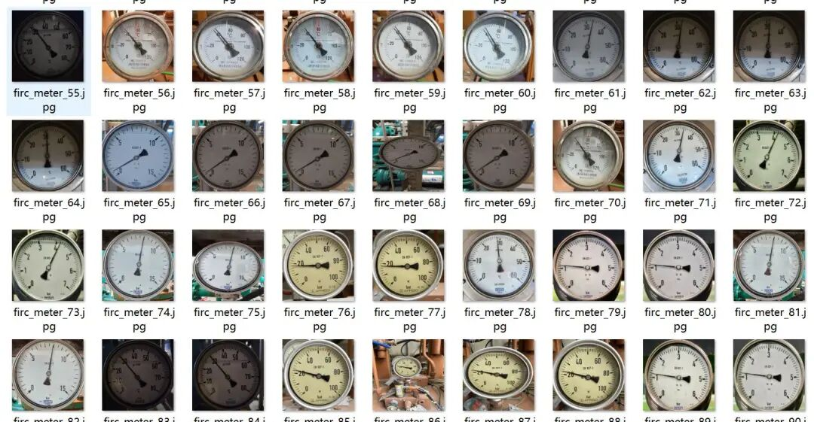
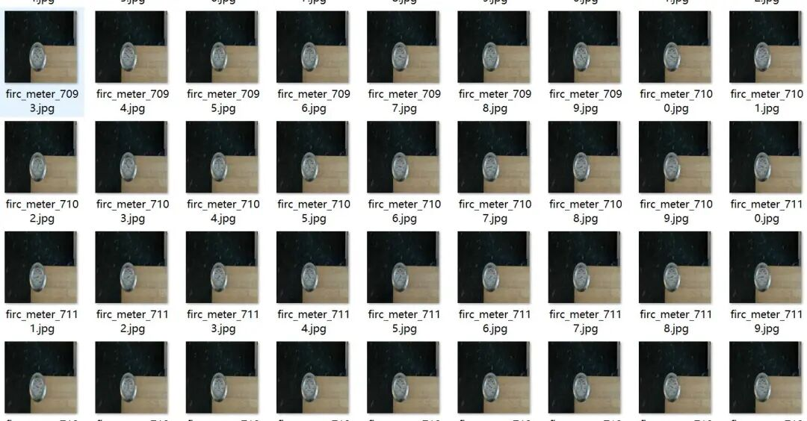
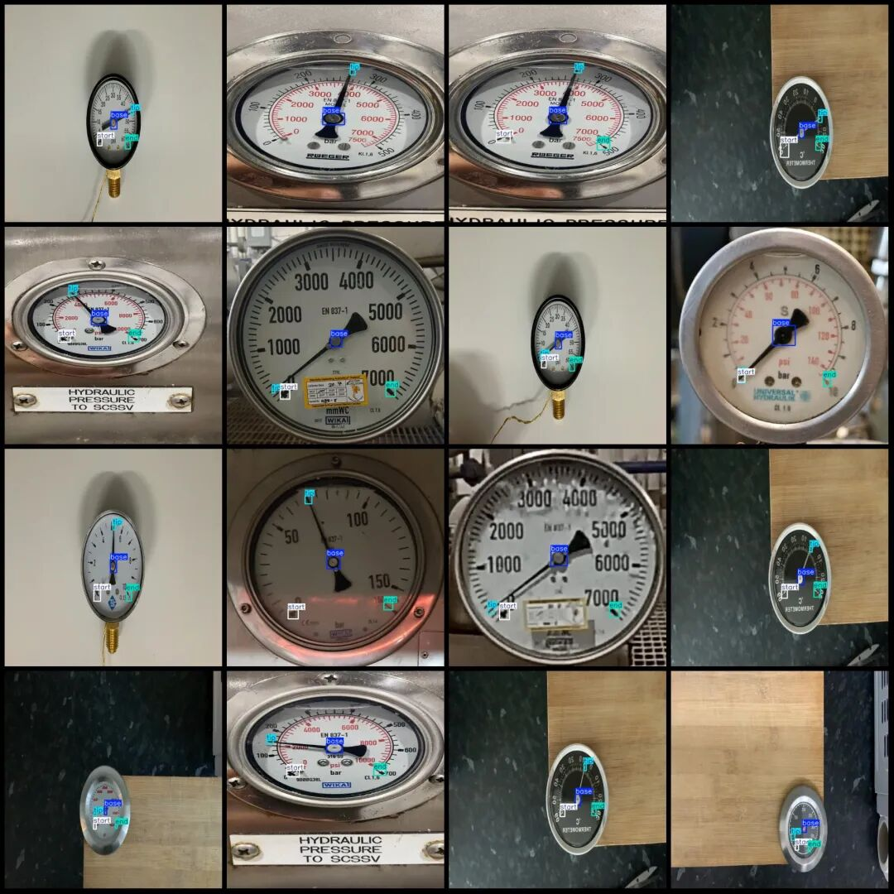
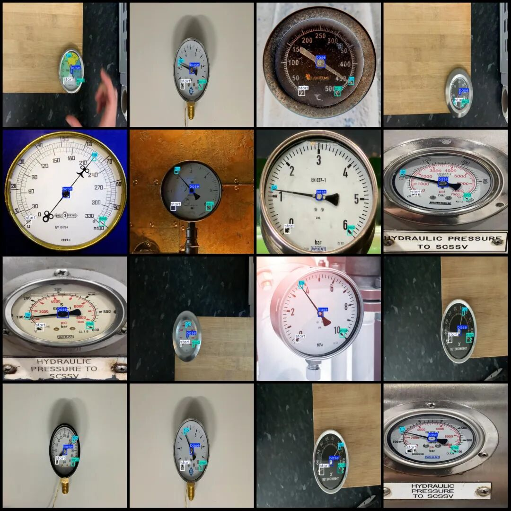

# Dataset for readings detection of circular instruments in power scenarios - VOC+YOLO format with 7698 images across 4 categories

Dataset format: Pascal VOC format + YOLO format (txt file without split path, only containing jpg images and corresponding VOC format xml files and yolo format txt files)

Number of images (number of jpg files): 7698

Number of annotations (number of xml files): 7698

Number of annotations (number of txt files): 7698

Labeling category count: 4

Label category names (note that the order of yolo format categories does not correspond to this, but is based on the classes.txt in the labels folder): ["base", "end", "start", "tip"]

Number of boxes labeled in each category:

Base Frame Count = 7670

End Frame Count = 7513

Start Frame Count = 7534

Tip Frame Count = 7683

Total frame count: 30400

Number of images per category:

Base occupancy count = 7662

Ending Ownership Image Count = 7495

Starting with the number of images owned = 7512

Tip: Number of images owned = 7673

Image resolution: 640x640

Using labelImg:

Annotation rules: Draw a rectangle around the category.

Important Notice: The dataset does not have separate training, validation, and test sets; you need to partition them yourself.

Special : This dataset does not guarantee the accuracy of the trained models or weight files.

Image Preview:

Annotation example:

## Payment

Here is a pay link on Stripe ( https://buy.stripe.com/3cs8yP7sY87d0vu9AB ). Please contact me lonlonago@foxmail.com after funding $89, and I will send you a complete data files , thank you!

